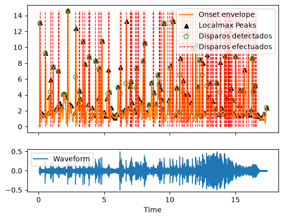

# Contador de disPyros

## 1. Descripción

Contadores de disparos basados en: 
- Un sistema acústico de detección. Desarrollado en Python con la librería _Librosa_ (ampliar en caso de poder desarrollar la red neuronal).
- Un modelo de _RandomForest_ previamente entrenado con características extraídas del audio de interés con funciones de la librería _pyAudioAnalysis_. 

## 2. Objetivo científico

Desarrollar una herramienta capaz de complementar pericias de escenas con disparos de armas de fuego.

## 3. Instalación

### Opción 1: usando uv

Crear y activar un entorno virtual:

```bash
uv venv
source .venv/bin/activate
```

Instalar las dependencias del proyecto:

```bash
uv pip install -r requirements.txt
```

### Opción 2: usando Conda

Crear y activar un entorno:

```bash
conda create -n nombre_entorno python=3.12
conda activate nombre_entorno
```

Instalar las dependencias:

```bash
pip install -r requirements.txt
```

### Verificación

Ejecutar:

```bash
python -c "import numpy, matplotlib, librosa; print('Instalación correcta')"
```

---------------------------------------
***--- FALTA ACTUALIZAR DE ACÁ PARA ABAJO ---***
---------------------------------------
## 4. Uso

### 4.1. Librosa

Para realizar un conteo de disparos, debe ejecutarse la función ```contador_disparos_librosa```, dentro de la libreria ```contadores.py```. La salida da la cantidad de disparos estimada por el programa y un gráfico que contiene:
* Señal del audio
* Picos de intensidad detectados
* Picos de intensidad clasificados como disparo

Sus argumentos son:
* ```audio``` (np.ndarray): Vector de muestras de audio largo que se desea auditar.
* ```salida``` (str o Path, opcional): Ruta del archivo CSV donde se guardará el reporte de detecciones. Por defecto es "conteo_disparos.csv".
* ```graficar``` (bool, opcional): Indica si se debe renderizar el gráfico estático de subplots en Matplotlib. Por defecto es ```False```.
* ```etiquetas_reales_csv``` (str o Path, opcional): Ruta del archivo CSV que contiene las anotaciones de laboratorio (disparos reales efectuados) para contrastar los resultados. Por defecto es ```None```.

El formato del archivo de audio puede ser cualquiera que sea compatible con ```soundfile```. Por ejemplo:
* WAV
* FLAC
* OGG
* AIFF
* MAT
* ALAC
* MP3
* RAW

Algunos archivos incompatibles son:
* AAC
* M4A
* MP4
* WMA
* AC3
* WebM

En el caso de utilizar archivos en formato MP3, debe asegurarse que la versión de la librería ```libsndfile``` es 1.1.0 o superior.

Para evaluar la eficiencia del contador de disparos, puede utilizarse ```validacion.py```. El archivo de audio se ingresa de la misma manera que en ```contador_disparos.py```, a la variable ```archivo```. Luego se necesita de un archivo de dos columnas (tiempo, intensidad) que contenga todos los disparos. Este útlimo archivo se carga en la variable ```etiquetas```. La salida devuelve los disparos detectados por el programa, los realmente efectuados y un gráfico que marca en qué instantes se detectaron disparos y en cuáles ocurrieron realmente.

### 4.2. Random Forest

Para utilizar el contador como modelo de Random Forest, debe ejecutarse la función ```contar_disparos_RF```, dentro de la libreria ```contadores.py```. No tiene una salida, sino que genera un archivo .csv donde se guardan los resultados.

Los argumentos son:

* ```audio``` (np.ndarray): Vector de muestras de audio largo que se desea auditar.
* ```salida``` (str): Ruta del archivo CSV donde se escribirá el reporte detallado.
* ```umbral``` (float): Probabilidad mínima (0.0 a 1.0) para validar un disparo positivo.
* ```prominencia``` (float): Porcentaje de la energía máxima requerido para detectar un pico de sonido.
* ```separacion``` (float): Tiempo de espera mínimo en segundos entre detecciones sucesivas.
* ```etiquetas_reales_csv``` (str): Ruta del archivo CSV con las etiquetas reales de disparos.

El formato del archivo de audio debe ser .wav.

## 5. Ejemplo de ejecución

El archivo ```ejecuciones_local.ipynb``` contiene un posible procedimiento para utilizar los dos modelos de contadores desarrollados. Se utilizan como datos los archivos que se encuentran en la carpeta ```audios```. Puede modificar las variables de la primera celda si desea, las cuales definen rutas de archivos. En particular, puede modificar:
* ```audio_ramallo```: Ruta del archivo de audio a analizar
* ```salida_RF```: Ruta del archivo de salida para el contador Random Forest
* ```salida_librosa```: Ruta del archivo de salida para el contador desarrollado con Librosa.
* ```etiquetas_reales_csv```: Ruta del archivo CSV que contiene las anotaciones de laboratorio (disparos reales efectuados) para contrastar los resultados.

En caso de que no disponga de audios y de un archivo con disparos etiquetados, solamente debe editar (no es obligatorio, puede dejar los valores que vienen por defecto) ```salida_RF``` y ```salida_librosa```.

## 6. Metodología

### 6.1. Librosa

Flujo del programa:
1. Lectura del archivo de audio
2. Aplicación de transformada de Fourier de tiempo corto (*Short-Time Fourier Transform* en inglés) STFT: Interesa únicamente la amplitud del espectro.
3. Conversión de amplitud a dB: Mejora la precisión ante los cambios de intensidad de sonido.
4. Cálculo de la diferencia de intensidad entre datos consecutivos: Se toma la intensidad en un tiempo dado y se le resta la intensidad del tiempo anterior. Esto se repite para todo el intervalo temporal. Interesan los tiempos en los cuales aumenta la intensidad, ya que puede indicar el inicio de un disparo. Por lo tanto, se descartan aquellas diferencias que resultan negativas.
5. Cálculo de la *novelty curve*: Se toma el promedio del cambio de intensidad de todas las frecuencias para los mismos tiempos.
6. Detección de los máximos de la *novelty curve*: Tomar todos los máximos como disparos es incorrecto. Deben evitarse máximos relacionados a la intensidad promedio de los datos y a otros sonidos que no son producidos por los disparos. Librosa provee un algoritmo que filtra máximos, quedándose con aquellos que están suficientemente separados y son suficientemente altos respecto de valores cercanos a los mismos.


Paso 4 y 5 los realiza automáticamente ```librosa.onset.onset_strenght```.

Paso 6 lo realiza ```librosa.util.localmax``` para detectar máximos y ```librosa.onset.onset_detect``` para filtrar los disparos.

### 6.2. Modelo con Random Forest

PENDIENTE

## 7. Validación

La eficiencia del contador se analiza ejecutando ```validacion.py```. Se utilizan los archivos ```audio/Audio 1 - Recorte Damian Kuc - Recortado.mp3``` y ```\audios\Masacre de Ramallo - Test\Audio 1 - Etiquetas.txt```. La siguiente imagen contiene los resultados obtenidos.



Para una secuencia de 105 disparos efectuados, se detectan 96. Esto no quiere decir que todos los sonidos clasificados como disparos sean efectivamente tal. El programa es capaz de detectar todos los disparos que están suficientemente separados temporalmente entre ellos y que no tienen algún sonido de interferencia. Se observa que el programa puede contabilizar interferencias (gritos, golpes, etc.) como disparos, además de no detectar disparos reales durante dicha interferencia. También se observa que cuando los disparos son suficientemente consecutivos, el programa no tiene la resolución temporal suficiente para detectarlos a todos.

## 8. Autores

* **Lucas Cabral** ([@lmc2098](https://github.com))
* **Justo Gonzalez Litardo** ([@justogl](https://github.com))

## 9. Licencia

Este proyecto está bajo la licencia MIT. Consulte el archivo [LICENSE](LICENSE) para más detalles.

Copyright (c) [2026] [Lucas Cabral y Justo Gonzalez Litardo]